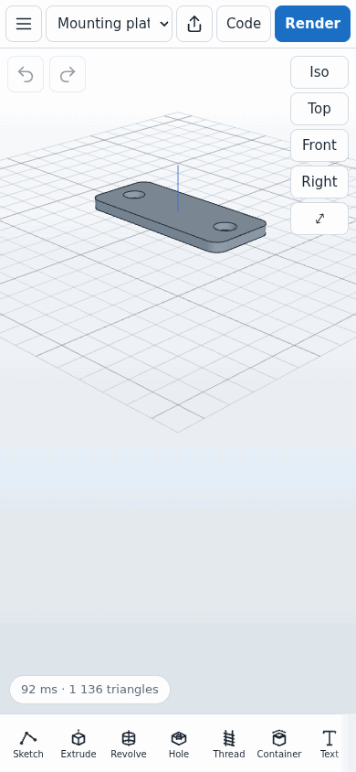
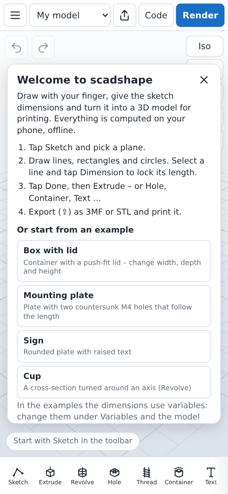
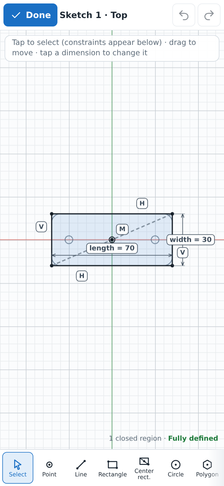
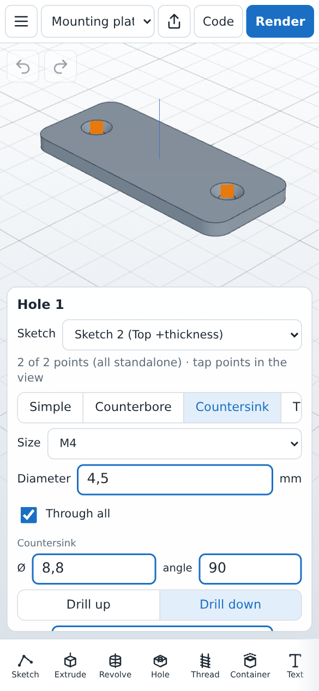
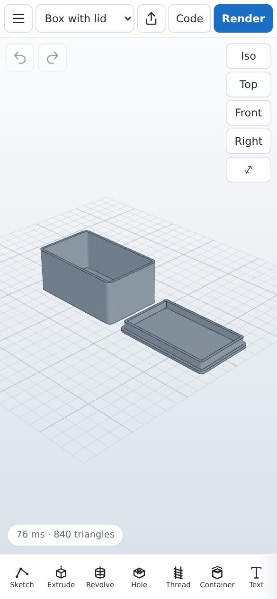
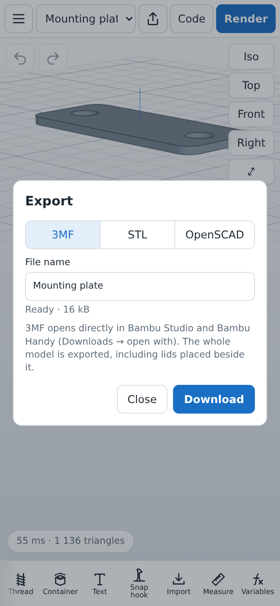

# scadshape

Parametric CAD for your phone, built on [OpenSCAD](https://openscad.org). Draw sketches with your
finger, constrain them with dimensions, turn them into features (extrude, revolve, holes, threads,
containers, text, snap fits …) and export 3MF/STL for 3D printing. Everything runs on the device,
offline: OpenSCAD (WebAssembly, Manifold backend) renders the model and FreeCAD's sketch solver
(planegcs) solves the constraints.

It runs as a web app (PWA) and as an Android app (a WebView wrapper with no permissions at all).
**Try it in your browser at [scadshape.com](https://scadshape.com)** · [Privacy policy](https://scadshape.com/privacy.html)
(it collects nothing).
To print, open the exported 3MF/STL in a slicer (Bambu Studio, OrcaSlicer, PrusaSlicer, …) – phone
printer apps such as Bambu Handy can't slice files themselves.

<p align="center">
  
  &nbsp;
  
</p>
<p align="center"><em>Sketch → part in a few taps · change a variable and the model follows</em></p>

> Status: early. The user interface is Swedish and English; the developer notes in `README.txt`
> are in Swedish.

## Screenshots

| | | | | |
|:-:|:-:|:-:|:-:|:-:|
|  |  |  |  |  |
| Getting started | Sketch with constraints | Features | Ready to print | Export 3MF/STL |

## Install (Android)

Download the APK from [Releases](https://github.com/aimfoot/scadshape/releases), or add
`https://github.com/aimfoot/scadshape` in [Obtainium](https://github.com/ImranR98/Obtainium) to
get updates automatically. Android 10 or newer. The app asks for no permissions and works fully
offline.

Package `io.github.aimfoot.scadshape`, signing certificate SHA-256:

```
80:C3:89:C6:B3:1B:12:5A:E2:F3:4D:82:B3:32:98:0B:F9:39:B5:AB:E4:96:27:96:13:54:44:7A:79:E3:EA:37
```

## Building

Requirements: Node.js 20+.

```sh
npm install
node build.mjs                 # → dist/
python3 serve.py               # http://127.0.0.1:8790/  (SCADSHAPE_HOST / SCADSHAPE_PORT to change)
```

Android (APK for testing, AAB for Google Play), without Gradle: see `android/README.txt`.
It needs a JDK 17+, the Android SDK build tools 36 and bundletool; paths are at the top of
`android/build.sh`.

## Tests

```sh
node tests/run.mjs             # unit tests (sketches, solver, projects, models, conversion)
```

Browser tests (Playwright, touch input) are in `tools/browser/`, one file per area. Run them
against a staging build:

```sh
node build.mjs --out dist-next
python3 -I -m http.server 8799 --bind 127.0.0.1 --directory dist-next
cd tools/browser && npm install && node smoke.mjs http://127.0.0.1:8799/
```

## Layout

| Path | What |
|---|---|
| `src/` | The app (TypeScript): sketcher, solver glue, features (`src/features/`), UI (`src/ui/`) |
| `public/` | HTML, CSS, icons, fonts |
| `vendor/openscad/` | OpenSCAD WebAssembly build (snapshot, see `VERSION`) |
| `vendor/libraries/` | OpenSCAD libraries loaded on demand (BOSL2, Round-Anything, dotSCAD, gridfinity) |
| `vendor/licenses/` | License texts for everything bundled (`tools/licenses.sh`) |
| `android/` | Android wrapper and build script |
| `tests/`, `tools/browser/` | Unit and browser tests |

## License

Copyright © 2026 scadshape contributors.

scadshape is free software: you can redistribute it and/or modify it under the terms of the GNU
General Public License as published by the Free Software Foundation, either version 3 of the
License, or (at your option) any later version. See [`LICENSE`](LICENSE).

It bundles third-party software under their own licenses (OpenSCAD and its libraries, CGAL,
Manifold, planegcs, three.js, fonts and OpenSCAD libraries); the full list and texts are in the
app under ☰ → About, in `src/licenses.ts` and in `vendor/licenses/`. The source code of the
OpenSCAD WebAssembly engine is at [openscad/openscad](https://github.com/openscad/openscad), built
with [openscad/openscad-wasm](https://github.com/openscad/openscad-wasm).
